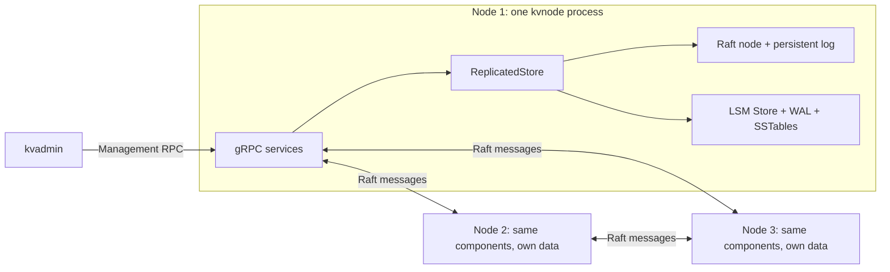

# Replicated Key-Value Store

**English** | [简体中文](README.zh-CN.md)

A persistent key-value store written in C++17, combining an LSM storage engine with three-node Raft replication over gRPC. Each node runs as an independent process and stores its own copy of the data.

The project implements the storage and consensus layers directly, including WAL recovery, immutable SSTables, background flush and compaction, leader election, log replication, and committed-command application. It is a systems learning project under active development. The local three-node cluster includes a client library and CLI with commit-confirmed writes, log-barrier reads, leader discovery, and explicit handling of uncertain write outcomes. A local fault matrix exercises partitions, message loss/delay/duplication/reordering, and crash recovery. Performance benchmarks are planned.

[Features](#features) · [Architecture](#architecture) · [Build and run](#build-and-run-locally) · [Testing](#testing) · [Scope](#scope-and-next-work)

## Features

| Storage engine | Replication and networking |
| --- | --- |
| Put, Get, and Delete with binary-safe keys and values | Three Raft members with configurable node IDs and ports |
| Checksummed write-ahead log and restart recovery | Persistent terms, votes, and replication logs |
| Ordered MemTables, immutable SSTables, and deletion tombstones | Leader election, heartbeats, and majority-based commits |
| Automatic background flush with WAL rotation and write backpressure | Log conflict repair and catch-up after a node rejoins |
| Streaming background compaction and safe file reclamation | Committed operations applied in order to each local Store |
| Per-table Bloom filters, in-memory block indexes, and a shared LRU block cache | gRPC transport, client library, and node/client/admin executables |
| Manifest-based file publication and exclusive data-file ownership | Partition, message-fault, crash-recovery, and restart tests |

## Architecture

Each `kvnode` contains the networking layer, Raft, and the storage engine in **one process**. The components call each other directly inside the node; gRPC carries messages between nodes.



The diagram shows the component layout; the elected leader can be any node. `kvadmin` connects to an explicitly chosen address.

### Replicated write path

1. `kvclient` discovers the leader and sends a Put/Delete through `KeyValue.Write`.
2. Raft persists the entry and replicates it to peers. The client RPC waits while replication advances.
3. Once Raft's majority and term rules allow the entry to commit, `ReplicatedStore` records the committed prefix and applies commands in order.
4. The local `Store` synchronizes its WAL and updates its MemTable before the client receives `OK`. Followers apply the entry after learning that it is committed. The diagnostic `kvadmin propose-put` still returns acceptance only.

The **Raft log** records the replicated command history; the **Store WAL** recovers local MemTable state. They are separate persistence layers with different responsibilities.

### Local reads and background work

```text
Get(key): active MemTable -> frozen MemTable -> SSTables, newest first
SSTable lookup: Bloom filter -> block index -> LRU cache / file -> exact key match

MemTable reaches threshold -> freeze + switch WAL -> background SSTable flush
SSTables reach threshold  -> background merge -> publish manifest -> reclaim old files
```

A client Get first commits and applies a fresh NoOp read barrier on the leader, then reads its local Store. Each read adds a log entry; there is no ReadIndex or lease optimization yet. Diagnostic `local-get` skips the barrier and may be stale.

Local lookups stop at the first value or tombstone, so older values cannot reappear after a delete. The manifest identifies the live SSTables and recovery WALs. File publication synchronizes a temporary manifest, renames it, and synchronizes the directory before obsolete files are removed.

Within a node, a state mutex serializes RPC and timer access to `ReplicatedStore`. Separate per-peer workers perform network sends without holding that mutex. The Store also has its own background flush and compaction workers.

## Build and run locally

Run all commands from the repository root. Requirements:

- A C++17 compiler and CMake 3.22 or newer for the full workflow below, including the pinned gRPC dependency build.
- A POSIX environment; development and validation currently use macOS. File locking, synchronization, and process tests use POSIX APIs.
- Git and network access for the optional gRPC dependency build.

### Storage engine and in-process demos

The default build requires no gRPC or Protobuf installation:

```sh
cmake -S . -B build -DBUILD_TESTING=ON -DKVSTORE_BUILD_GRPC=OFF
cmake --build build
```

After editing source files, rerun `cmake --build build` before running the program. For the network build below, use `cmake --build build/network` instead.

Use the persistent single-node CLI:

```sh
mkdir -p build/demo
./build/kvstore build/demo/store.wal put name Alice
./build/kvstore build/demo/store.wal get name
# Alice
./build/kvstore build/demo/store.wal flush
./build/kvstore build/demo/store.wal compact
./build/kvstore build/demo/store.wal delete name
```

Each command opens the same persistent Store in a new process. `build/demo/store.wal` is the Store's base path, also used to name its manifest, SSTables, lock, and numbered WALs. Its parent directory must exist. Continue using the same base path after flushing or compaction.

| Command after the base path | Effect |
| --- | --- |
| `put KEY VALUE` | Persist a value; print `OK` |
| `get KEY` | Print the value; a missing key prints `<not found>` and exits with code 1 |
| `delete KEY` | Persist a tombstone; report whether a value was visible |
| `flush` | Flush pending entries to an SSTable and wait for publication |
| `compact` | Merge existing SSTables and wait; does not first flush the active MemTable |
| `recover-tail` | Explicitly discard an incomplete current-WAL suffix; does not repair arbitrary corruption |

Two self-contained demos use temporary data and simulate message delivery within a single process:

```sh
./build/raft_demo
./build/replica_demo
```

`raft_demo` demonstrates elections, replication, and conflicts. `replica_demo` adds actual Store reads, committed writes, and recovery. Use the next section for separate processes communicating over the network.

### Three-node gRPC cluster

Build the pinned gRPC dependency and its matching Protobuf tools inside `build/deps/`:

```sh
sh scripts/build-grpc.sh
```

The first build downloads and compiles dependencies and can take several minutes. The script pins gRPC 1.84.0 and its dependency revisions, installs locally, and can reuse an existing build. `KVSTORE_BUILD_JOBS` controls dependency build parallelism; the default is 4.

Configure and build the network targets:

```sh
cmake -S . -B build/network \
  -DKVSTORE_BUILD_GRPC=ON \
  -DBUILD_TESTING=ON \
  -DCMAKE_PREFIX_PATH="$PWD/build/deps/install" \
  -DCMAKE_EXPORT_COMPILE_COMMANDS=ON
cmake --build build/network
mkdir -p build/cluster
```

Start one command in each of **three terminals**, with each terminal in the repository root:

```sh
# Terminal 1
./build/network/kvnode --id 1 --directory build/cluster/node1 --mode new \
  --members 1=127.0.0.1:50051,2=127.0.0.1:50052,3=127.0.0.1:50053
```

```sh
# Terminal 2
./build/network/kvnode --id 2 --directory build/cluster/node2 --mode new \
  --members 1=127.0.0.1:50051,2=127.0.0.1:50052,3=127.0.0.1:50053
```

```sh
# Terminal 3
./build/network/kvnode --id 3 --directory build/cluster/node3 --mode new \
  --members 1=127.0.0.1:50051,2=127.0.0.1:50052,3=127.0.0.1:50053
```

Use the same membership map on every node and a separate data directory for each. `--mode new` requires that the node directory does not already exist; create only the parent `build/cluster`. For a previously initialized node, use `--mode existing` with the same identity and data directory.

In a fourth terminal, use the client without choosing a leader address:

```sh
cluster_members='1=127.0.0.1:50051,2=127.0.0.1:50052,3=127.0.0.1:50053'
./build/network/kvclient "$cluster_members" put name Alice
./build/network/kvclient "$cluster_members" get name
./build/network/kvclient "$cluster_members" delete name
./build/network/kvclient "$cluster_members" --timeout-ms 3000 get name
```

Successful writes print `OK index=N term=T` only after commitment and local application. A missing Get prints `<not found>` and exits with code 3. Reads use a fresh majority-backed log barrier; they never fall back to a stale local read.

Write uncertainty prints `UNKNOWN` and exits with code 4. A timeout does not undo a write. The client retries writes only after an explicit pre-proposal `NOT_LEADER` rejection, with gRPC built-in retries disabled. It never automatically replays a possibly accepted write. If no leader operation can be attempted within the budget, the exit code is 1. Argument errors use code 2; successful operations use code 0. There is no request deduplication or exactly-once guarantee. See [client semantics](docs/steps/17-client-semantics.md) for API results, deadlines, and limitations.

For diagnostics, inspect the election result with `kvadmin`:


```sh
./build/network/kvadmin 127.0.0.1:50051 status
./build/network/kvadmin 127.0.0.1:50052 status
./build/network/kvadmin 127.0.0.1:50053 status
```

Status reports `id`, `role`, `term`, `leader`, `log`, `commit`, and `applied`. Wait for a leader to be elected; node 1 is not guaranteed to win. `leader=0` means the leader is not yet known to that node.

For example, **if port 50052 belongs to the elected leader**, submit a write there:

```sh
./build/network/kvadmin 127.0.0.1:50052 propose-put name Alice
```

The response is `ACCEPTED index=N term=T`. Replace `INDEX` and `TERM` below with those returned numbers:

```text
./build/network/kvadmin 127.0.0.1:50052 applied INDEX TERM
```

If it returns `false`, check again later. A successful proposal receipt alone does not mean the write has committed. After application, inspect local values; followers may need more time to catch up:

```sh
./build/network/kvadmin 127.0.0.1:50051 local-get name
./build/network/kvadmin 127.0.0.1:50052 local-get name
./build/network/kvadmin 127.0.0.1:50053 local-get name
```

Submit a deletion to the current leader with `propose-delete name`, and check its returned receipt in the same way. Press **Ctrl+C** in each node terminal to stop. Restart with the corresponding command using `--mode existing`.

`kvadmin` is an administration tool: it does not discover the leader, forward follower proposals, or retry writes. `local-get` reads that node's applied state and may return stale data, including from an isolated former leader. These are not linearizable client reads. Exit codes are 0 for a successful RPC, 1 for an RPC error, 2 for invalid arguments, and 3 for a missing local key; `applied` returning `false` still exits with code 0.

## Testing

Run the non-network suite after the default build:

```sh
ctest --test-dir build --output-on-failure
```

Run the full suite, including real three-process tests, after the network build:

```sh
ctest --test-dir build/network --output-on-failure
```

To run only the network tests:

```sh
ctest --test-dir build/network -R '^(grpc_.*|client_process|cluster_fault)$' --output-on-failure
```

The current builds contain 19 and 23 CTest groups respectively. Coverage includes record corruption and truncation, WAL replay, manifest publication, tombstones, background-task interleavings, indexes and caching, Raft elections and conflict resolution, committed application, and process crashes. Network tests cover real KV replication, leader termination and re-election, node restart and catch-up, invalid RPCs, concurrent administration calls, and shutdown. Client tests additionally cover commit acknowledgements, quorum loss, read barriers, safe redirection, lost replies after real commits, and uncertain CLI outcomes. The seven cluster fault scenarios additionally cover live-leader isolation, follower isolation, one-way loss, complete partition, two mixed message schedules, combined crash/restart, and route validation. Tests create their own temporary data; network tests require permission to bind loopback ports and spawn child processes.

Both the ordinary and AddressSanitizer/UndefinedBehaviorSanitizer network builds have passed the full suite. Latest validation results and instrumentation limits are recorded in the [cluster fault notes](docs/steps/18-cluster-faults.md#验证结果与范围). The earlier [directory reorganization](docs/steps/16a-project-layout.md) also records the thread checks and fresh-build verification performed at that stage. Test duration is not a throughput or latency benchmark.

To run the fault matrix alone, with scenario progress and message counters:

```sh
ctest --test-dir build/network -R '^cluster_fault$' -V --output-on-failure
```

It automatically starts three node processes and test-only forwarding endpoints on temporary ports, then cleans them up. Nodes optionally accept `--raft-routes MEMBERS` to route outbound Raft traffic through proxies; their listening and client addresses still come from `--members`. Normal startup needs no routing override. The fault scheduler is compiled only into the test executable.

## Project layout

```text
include/kvstore/     Public engine, Raft, replication, and RPC interfaces
src/engine/         LSM engine, local recovery, background flush and compaction
src/raft/           Raft state machine, replication, and persistent log
src/replica/        Raft-to-Store coordinator and commit checkpoint
src/rpc/            gRPC runtime, client, codec, configuration, and optional CMake rules
src/common/         Internal file I/O and byte-encoding helpers
apps/               kvstore, kvnode, kvadmin, and kvclient entry points
examples/           In-process Raft and replicated Store demos
proto/              Protobuf message and service definitions
tests/              Tests grouped into engine/, raft/, replica/, and rpc/
scripts/            Project-local dependency build
docs/              Architecture and implementation walkthroughs (Chinese)
```

The root `CMakeLists.txt` defines the core libraries, applications, and demos. Enabling `KVSTORE_BUILD_GRPC` also loads `src/rpc/CMakeLists.txt`; enabling tests loads `tests/CMakeLists.txt`, all within the same build. Executables keep their existing paths at the build-directory root. Generated Protobuf files stay under `build/network/src/rpc/generated/`; do not edit them. For IDE header resolution, use the network build's `compile_commands.json`, which includes the generated and dependency include directories.

## Scope and next work

- The network runtime currently supports exactly three static members on `127.0.0.1`, using plaintext gRPC without authentication.
- The client implements consistent reads and commit-confirmed writes. Reads append NoOps; there is no request deduplication, automatic replay of uncertain writes, or exactly-once guarantee.
- Transactions, MVCC, snapshots, Raft log truncation, and leveled compaction are not implemented. Store compaction reclaims SSTables; it does not compact the Raft log.
- SSTable Bloom filters and block indexes are rebuilt in memory when tables open. Foreground Store operations currently share a coarse mutex, and writes synchronize the WAL individually.
- A finite local fault matrix now covers partitions, one-way loss, delayed/duplicated/reordered envelopes, crash recovery, and convergence. It is not an exhaustive history checker or a simulation of every TCP failure. Reproducible mixed-workload throughput and P50/P95/P99 benchmarks remain planned; no performance figures are claimed.

## Further reading

- [Cluster fault matrix](docs/steps/18-cluster-faults.md): forwarding, scenarios, correctness checks, and validation limits.
- [Client semantics and usage](docs/steps/17-client-semantics.md): leader discovery, write outcomes, consistent reads, and retries.
- [System architecture](docs/architecture.md): module boundaries, replicated writes, persistence, and threads.
- [Storage architecture](docs/storage-engine.md): local read/write paths, file lifecycle, locking, and recovery.
- [Directory reorganization](docs/steps/16a-project-layout.md): old-to-new paths and regression results.
- [Raft and Store integration](docs/steps/15-raft-store.md): committed application and restart recovery.
- [gRPC runtime and three-process operation](docs/steps/16-grpc-processes.md): transport, threads, configuration, and failure handling.
- [Roadmap](ROADMAP.md) and [completion criteria](GOAL.md): implementation sequence and remaining work.
- [Implementation walkthroughs](docs/steps/): step-by-step design notes and C++ explanations, written in Chinese.
