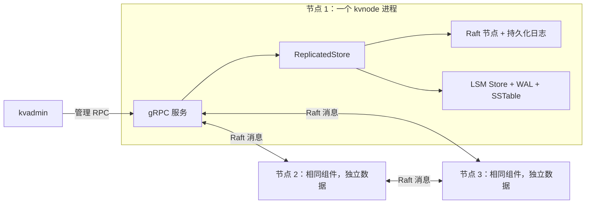

# Replicated Key-Value Store

[English](README.md) | **简体中文**

一个使用 C++17 实现的持久化键值存储，将 LSM 存储引擎与基于 gRPC 的三节点 Raft 复制结合起来。每个节点作为独立进程运行，保存自己的数据副本。

项目直接实现存储与共识的核心逻辑，包括 WAL 恢复、不可变 SSTable、后台刷盘与合并、选主、日志复制及已提交命令的执行。目前本机三节点集群已可运行，包含客户端库和命令行工具，提供提交确认、一致性读屏障、Leader 发现及明确的写入未知结果语义。本机故障矩阵已覆盖分区、消息丢失／延迟／重复／乱序及崩溃恢复；可复现混合负载 benchmark 记录完整调用的吞吐量与 P50/P95/P99 延迟。这是一个系统学习项目，当前范围和测量限制见下文。

[功能](#功能) · [架构](#架构) · [构建与运行](#构建与本地运行) · [测试](#测试) · [性能测量](#性能测量) · [当前范围](#当前范围与后续工作)

## 功能

| 存储引擎 | 复制与网络 |
| --- | --- |
| Put、Get、Delete，键和值支持二进制字节 | 三个 Raft 成员，可配置节点 ID 和端口 |
| 带校验的预写日志及重启恢复 | 任期、投票与复制日志持久化 |
| 有序 MemTable、不可变 SSTable、删除标记 | Leader 选举、心跳与多数派提交 |
| 自动后台刷盘、WAL 轮换和写入背压 | 日志冲突修正及节点重新加入后的追赶 |
| 流式后台合并和安全文件回收 | 已提交命令按顺序应用到各节点的本地 Store |
| 每表 Bloom 过滤器、内存块索引、共享 LRU 块缓存 | gRPC 传输、客户端库及节点／客户端／管理程序 |
| 基于 manifest 的文件发布和数据文件独占打开 | 网络分区、消息故障、进程崩溃与重启测试 |

## 架构

每个 `kvnode` 在**同一个进程内**包含网络层、Raft 和存储引擎。节点内部通过函数调用连接各模块，节点之间通过 gRPC 传递消息。



图中展示的是组件关系，任一节点都可能当选 Leader。`kvadmin` 连接的是使用者明确指定的地址。

### 复制写入流程

1. `kvclient` 自动发现 Leader，通过 `KeyValue.Write` 提交 Put/Delete。
2. Raft 持久化日志条目并复制给其他节点；客户端 RPC 释放状态锁等待复制推进。
3. 满足 Raft 的多数派与任期规则后，`ReplicatedStore` 保存已提交前缀的依据，并按顺序执行命令。
4. 本地 `Store` 同步 WAL 并更新 MemTable 后，客户端才收到 `OK`。Follower 得知条目已提交后也会执行。管理工具 `kvadmin propose-put` 仍只返回接收提议的回执。

**Raft 日志**记录需要复制的命令历史，**Store WAL**用于恢复本地 MemTable。两者是职责不同的持久化层。

### 本地查询与后台任务

```text
Get(key)：可写 MemTable → 冻结 MemTable → 从新到旧查询 SSTable
SSTable 查询：Bloom 过滤器 → 块索引 → LRU 缓存或文件读取 → 精确匹配 key

MemTable 达到阈值 → 冻结并切换 WAL → 后台刷出 SSTable
SSTable 达到数量阈值 → 后台合并 → 发布 manifest → 回收旧文件
```

正式客户端 Get 先在 Leader 上提交并执行一条新的 NoOp 读屏障，再查询本地 Store。每次读都会增加一条日志，目前没有 ReadIndex 或租约读取优化。管理工具的 `local-get` 跳过屏障，可能读到旧数据。

本地查询遇到第一个值或删除标记就停止，避免删除后读出旧值。manifest 指定有效的 SSTable 和用于恢复的 WAL。发布文件状态时，先同步临时 manifest，再替换正式文件并同步目录，之后才能回收旧文件。

节点内的一把状态锁串行保护 RPC 回调和计时线程对 `ReplicatedStore` 的访问。每个对端有独立发送线程，网络发送期间不持有这把锁。Store 内部另有后台刷盘和合并线程。

## 构建与本地运行

以下命令都在项目根目录执行。需要：

- 支持 C++17 的编译器，以及 CMake 3.22 或更新版本，以完成下面包含固定版本 gRPC 依赖构建的完整流程。
- POSIX 环境；目前开发和验证使用 macOS。文件锁、同步及进程测试使用 POSIX API。
- 构建可选的 gRPC 依赖时，需要 Git 和网络连接。

### 存储引擎与进程内演示

默认构建不需要安装 gRPC 或 Protobuf：

```sh
cmake -S . -B build -DBUILD_TESTING=ON -DKVSTORE_BUILD_GRPC=OFF
cmake --build build
```

修改源文件后，先重新执行 `cmake --build build` 再运行程序。对于下文的网络构建，使用 `cmake --build build/network`。

运行持久化的单机命令行程序：

```sh
mkdir -p build/demo
./build/kvstore build/demo/store.wal put name Alice
./build/kvstore build/demo/store.wal get name
# Alice
./build/kvstore build/demo/store.wal flush
./build/kvstore build/demo/store.wal compact
./build/kvstore build/demo/store.wal delete name
```

每条命令会在一个新进程中打开同一份持久化 Store。`build/demo/store.wal` 是 Store 的基础路径，也用于命名 manifest、SSTable、锁及编号 WAL；它的父目录必须存在。刷盘或合并后仍使用相同基础路径打开。

| 基础路径之后的命令 | 作用 |
| --- | --- |
| `put KEY VALUE` | 持久化一个值，输出 `OK` |
| `get KEY` | 输出值；不存在时输出 `<not found>`，退出码为 1 |
| `delete KEY` | 持久化删除标记，并报告操作前是否存在可见值 |
| `flush` | 将待刷出的条目写入 SSTable，等待发布完成 |
| `compact` | 合并已有 SSTable 并等待完成；不会先刷出可写 MemTable |
| `recover-tail` | 显式丢弃当前 WAL 不完整的尾部；不能修复任意损坏 |

以下两个独立演示使用临时数据，在单进程内模拟消息交付：

```sh
./build/raft_demo
./build/replica_demo
```

`raft_demo` 展示选举、复制和冲突处理；`replica_demo` 加入真实 Store 查询、已提交写入及恢复。需要运行通过网络通信的独立进程时，使用下一节的方式。

### 三节点 gRPC 集群

首先将固定版本的 gRPC 依赖和配套 Protobuf 工具构建到项目内的 `build/deps/`：

```sh
sh scripts/build-grpc.sh
```

首次执行会下载和编译依赖，可能需要数分钟。脚本固定 gRPC 1.84.0 及其依赖版本，安装在项目内，可以复用已有构建。`KVSTORE_BUILD_JOBS` 可设置依赖构建的并行数，默认为 4。

配置并构建网络目标：

```sh
cmake -S . -B build/network \
  -DKVSTORE_BUILD_GRPC=ON \
  -DBUILD_TESTING=ON \
  -DCMAKE_PREFIX_PATH="$PWD/build/deps/install" \
  -DCMAKE_EXPORT_COMPILE_COMMANDS=ON
cmake --build build/network
mkdir -p build/cluster
```

打开**三个终端**，每个终端都进入项目根目录，分别运行：

```sh
# Terminal 1
./build/network/kvnode --id 1 --directory build/cluster/node1 --mode new \
  --members 1=127.0.0.1:50051,2=127.0.0.1:50052,3=127.0.0.1:50053
```

```sh
# Terminal 2
./build/network/kvnode --id 2 --directory build/cluster/node2 --mode new \
  --members 1=127.0.0.1:50051,2=127.0.0.1:50052,3=127.0.0.1:50053
```

```sh
# Terminal 3
./build/network/kvnode --id 3 --directory build/cluster/node3 --mode new \
  --members 1=127.0.0.1:50051,2=127.0.0.1:50052,3=127.0.0.1:50053
```

所有节点使用相同的成员映射，各自使用独立数据目录。`--mode new` 要求节点目录尚不存在，因此只提前创建父目录 `build/cluster`。已经初始化过的节点应使用 `--mode existing`，并保留原节点身份和数据目录。

在第四个终端使用客户端，不需要先选择 Leader 的地址：

```sh
cluster_members='1=127.0.0.1:50051,2=127.0.0.1:50052,3=127.0.0.1:50053'
./build/network/kvclient "$cluster_members" put name Alice
./build/network/kvclient "$cluster_members" get name
./build/network/kvclient "$cluster_members" delete name
./build/network/kvclient "$cluster_members" --timeout-ms 3000 get name
```

写入只有提交并在本节点执行完成后才输出 `OK index=N term=T`。Get 不存在时输出 `<not found>`，退出码为 3。读取使用新的多数派日志屏障，不会退回可能过期的本地查询。

写入结果未知时输出 `UNKNOWN`，退出码为 4；超时不撤销写入。只有明确的“尚未追加提议”的 `NOT_LEADER` 回复才允许自动换节点重试，并关闭 gRPC 内置重试。可能已经接受的写入不会自动重放。总期限内未能发起可用的 Leader 操作时退出码为 1，参数错误为 2，成功为 0。当前没有请求去重或 exactly-once 保证。API 结果、期限和边界见[客户端语义](docs/steps/17-client-semantics.md)。

需要诊断时，使用 `kvadmin` 查看选举结果：


```sh
./build/network/kvadmin 127.0.0.1:50051 status
./build/network/kvadmin 127.0.0.1:50052 status
./build/network/kvadmin 127.0.0.1:50053 status
```

状态包含 `id`、`role`、`term`、`leader`、`log`、`commit`、`applied`。等待集群选出 Leader；不保证节点 1 当选。`leader=0` 表示该节点暂时不知道 Leader。

例如，**如果查看后确认 50052 对应当选的 Leader**，向它提交写入：

```sh
./build/network/kvadmin 127.0.0.1:50052 propose-put name Alice
```

响应为 `ACCEPTED index=N term=T`。将返回的两个数字填入下面的 `INDEX` 和 `TERM`：

```text
./build/network/kvadmin 127.0.0.1:50052 applied INDEX TERM
```

返回 `false` 时可以稍后再次检查。提议接收成功本身不代表写入已经提交。执行完成后可查看各节点的本地值；Follower 可能还需要一些时间追赶：

```sh
./build/network/kvadmin 127.0.0.1:50051 local-get name
./build/network/kvadmin 127.0.0.1:50052 local-get name
./build/network/kvadmin 127.0.0.1:50053 local-get name
```

删除时向当前 Leader 提交 `propose-delete name`，再用相同方式检查返回的回执。停止时在各节点终端按 **Ctrl+C**；重启时使用对应启动命令，并改为 `--mode existing`。

`kvadmin` 是管理工具，不会自动发现 Leader、转发 Follower 上的提议或重试写入。`local-get` 读取指定节点已经执行的本地状态，可能读到落后数据，包括被隔离的旧 Leader 上的数据，因此不提供线性一致读。成功 RPC 的退出码为 0，RPC 错误为 1，参数错误为 2，本地 key 不存在为 3；`applied` 返回 `false` 时退出码仍为 0。

## 测试

默认构建完成后，运行不含网络的测试：

```sh
ctest --test-dir build --output-on-failure
```

网络构建完成后，运行包含真实三进程测试的完整测试：

```sh
ctest --test-dir build/network --output-on-failure
```

只运行网络测试：

```sh
ctest --test-dir build/network -R '^(grpc_.*|client_process|cluster_fault)$' --output-on-failure
```

当前两种构建分别包含 19 和 23 组 CTest。覆盖记录损坏与截断、WAL 回放、manifest 发布、删除标记、后台任务交错、索引和缓存、Raft 选举与冲突修正、提交执行及进程崩溃。网络测试覆盖真实 KV 复制、Leader 被终止后重选、节点重启追赶、非法 RPC、并发管理调用及关闭。客户端测试还覆盖提交确认、失去多数派、读屏障、安全重定向、实际提交后的回复丢失及 CLI 未知结果。七类集群故障场景进一步覆盖存活 Leader 隔离、Follower 隔离、单向丢失、完全分区、两种混合消息序列、崩溃／重启组合及路由校验。测试使用独立临时数据；网络测试需要允许绑定回环端口和启动子进程。

启用 benchmark 的 Release 和 AddressSanitizer/UndefinedBehaviorSanitizer 构建均已通过全部 25 组测试，包含原有 23 组。最新验证记录和插桩范围见[benchmark 说明](docs/steps/19-benchmark.md#自动化回归)，消息故障矩阵见[集群故障说明](docs/steps/18-cluster-faults.md#验证结果与范围)。此前[目录整理](docs/steps/16a-project-layout.md)记录了当时完成的线程检查和全新目录构建验证。测试耗时不等于吞吐量或延迟 benchmark。

单独运行故障矩阵，并显示场景进度及消息计数：

```sh
ctest --test-dir build/network -R '^cluster_fault$' -V --output-on-failure
```

测试会自动选择临时端口，启动三个节点进程与测试转发器，再清理它们。节点可通过 `--raft-routes MEMBERS` 将出站 Raft 消息发给代理；监听和客户端地址仍由 `--members` 指定。正常启动无需路由覆盖。故障调度器只编译到测试程序中。

## 性能测量

使用同一份本地依赖，单独创建 Release 性能构建，启用可选 benchmark：

```sh
cmake -S . -B build/release -DCMAKE_BUILD_TYPE=Release -DKVSTORE_BUILD_GRPC=ON -DKVSTORE_BUILD_BENCHMARKS=ON -DBUILD_TESTING=ON -DCMAKE_PREFIX_PATH="$PWD/build/deps/install"
cmake --build build/release
python3 scripts/benchmark.py --build-dir build/release
```

运行脚本需要 Python 3.9 或更新版本，只使用标准库。每轮自动启动全新的三节点集群，预装 256 个 key、预热 128 条请求，再用持续运行的 C++ Client 测量 1000 条请求。默认负载为 95% Get / 5% Put 和 50% Get / 40% Put / 10% Delete，各自使用并发 1、4，每种组合重复三次，无需手动启动节点。

命令最后打印 `build/benchmark-results/` 下的报告位置。报告保留每轮结果、逐条延迟、结果计数、各操作统计、构建与机器信息，以及节点日志和数据；不会覆盖已有输出目录。启用 benchmark 的测试构建新增 `benchmark_workload` 和 `benchmark_smoke`，共 25 组 CTest，其他构建配置的测试数量不变。

吞吐量按正式总时间内的成功调用数计算；延迟包含完整 Client 调用、Leader 发现和读取的新 NoOp 屏障。这是单台机器、小工作集的闭环测试，没有固定到达速率，也不代表大 SSTable 或缓存性能。参数、逐轮结果和解释范围见[测量方法](docs/steps/19-benchmark.md)与[本机实测记录](docs/benchmarks/step19-local.md)。正式测量应在其他构建和测试结束后单独运行。

## 项目结构

```text
include/kvstore/     存储引擎、Raft、复制协调层及 RPC 的公开接口
src/engine/         LSM 引擎、本地恢复、后台刷盘与合并
src/raft/           Raft 状态机、复制及持久化日志
src/replica/        Raft 与 Store 的协调层及提交记录
src/rpc/            gRPC 运行层、客户端、编解码、配置和可选构建规则
src/common/         内部文件操作和字节编码工具
apps/               kvstore、kvnode、kvadmin、kvclient 的程序入口
examples/           进程内的 Raft 和复制存储演示
benchmarks/         可选的持久客户端负载与统计工具
proto/              Protobuf 消息和服务定义
tests/              存储、Raft、复制、RPC 和 benchmark 流程测试
scripts/            项目内依赖构建与性能测试编排
docs/               架构说明和逐步实现讲解，使用中文
```

根目录的 `CMakeLists.txt` 定义核心库、应用和演示；启用 `KVSTORE_BUILD_GRPC` 后读取 `src/rpc/CMakeLists.txt`，启用测试后读取 `tests/CMakeLists.txt`，都属于同一次构建。可执行程序仍输出到构建目录根部，原运行路径保持不变。Protobuf 生成文件位于 `build/network/src/rpc/generated/`，不要手动修改。编辑器解析头文件时，可使用网络构建生成的 `compile_commands.json`，其中包含生成目录和依赖头文件目录。

## 当前范围与后续工作

- 网络运行层目前支持三个静态成员，仅接受 `127.0.0.1` 地址，使用无认证的明文 gRPC。
- 客户端已提供一致性读取和提交确认。每次读取追加 NoOp；暂不提供请求去重、不确定写入的自动重放或 exactly-once 保证。
- 暂无事务、MVCC、快照、Raft 日志截断及分层合并。Store 的 compaction 回收 SSTable，不负责压缩 Raft 日志。
- SSTable 的 Bloom 过滤器和块索引在打开文件时重建到内存。Store 的前台操作目前共用一把较大粒度的锁，每条写入单独同步 WAL。
- 本机有限故障矩阵覆盖分区、单向丢失、消息延迟／重复／乱序、崩溃恢复和数据收敛；它不是穷尽所有历史的检查器，也不模拟 TCP 的每一种故障。benchmark 记录本机有限混合负载；大数据集、冷缓存、长期合并和固定到达速率下的容量尚未测量。

## 延伸阅读

- [Benchmark 测量方法](docs/steps/19-benchmark.md)与[本机结果](docs/benchmarks/step19-local.md)：负载、计时、逐条样本与解释范围。
- [集群故障矩阵](docs/steps/18-cluster-faults.md)：转发机制、场景、正确性检查和验证范围。
- [客户端语义与使用](docs/steps/17-client-semantics.md)：Leader 发现、写入结果、一致性读取与重试。
- [总体架构](docs/architecture.md)：模块职责、复制写入、持久化与线程。
- [单机存储架构](docs/storage-engine.md)：本地读写路径、文件生命周期、锁与恢复。
- [目录整理记录](docs/steps/16a-project-layout.md)：旧新路径对照和回归验证结果。
- [Raft 与 Store 集成](docs/steps/15-raft-store.md)：提交执行和重启恢复。
- [gRPC 运行层与三进程使用](docs/steps/16-grpc-processes.md)：传输、线程、配置及故障处理。
- [开发路线](ROADMAP.md)与[完成标准](GOAL.md)：实现顺序和剩余工作。
- [逐步实现讲解](docs/steps/)：按步骤记录设计和 C++ 知识点，使用中文。
