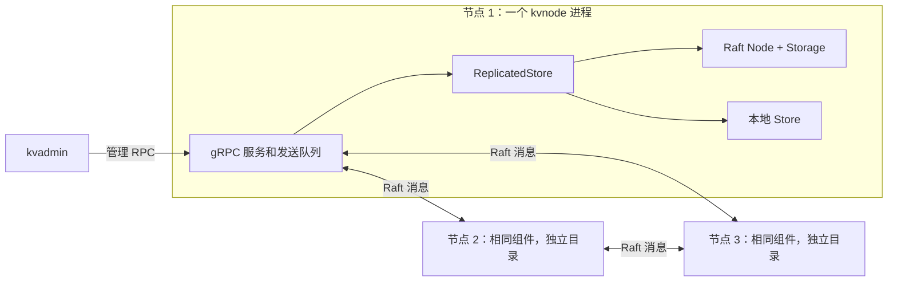

# 项目总体架构

当前系统由 LSM 存储引擎、Raft 共识模块、复制协调层和 gRPC 运行层组成。三个 `kvnode` 进程各有一份独立数据；节点内部使用对象和函数调用连接，节点之间使用 gRPC。

## 先区分库与程序

| 目录 | 职责 | 主要文件 |
| --- | --- | --- |
| `src/engine/` | 单机 KV 存储与本地恢复 | `store.cpp`、`sstable.cpp`、`background_flush.cpp`、`background_compaction.cpp` |
| `src/raft/` | 选举、复制、提交和协议持久化 | `node.cpp`、`replication.cpp`、`storage.cpp` |
| `src/replica/` | 将已提交日志应用到 Store，保存恢复依据 | `replicated_store.cpp`、`replica_checkpoint.cpp` |
| `src/rpc/` | 消息转换、网络服务、计时、发送线程和生命周期 | `node_server.cpp`、`protocol_codec.cpp`、`config.cpp` |
| `src/common/` | 共享的内部文件操作和编码 | `file_io.h/.cpp`、`coding.h` |
| `apps/` | 命令行参数解析及程序入口 | `kvstore_main.cpp`、`kvnode_main.cpp`、`kvadmin_main.cpp`、`kvclient_main.cpp` |
| `examples/` | 进程内模拟消息交付的演示 | `raft_demo.cpp`、`replica_demo.cpp` |
| `tests/` | 按 engine、raft、replica、rpc 分组的验证 | 各模块的 `*_test.cpp` |

公开接口放在 `include/kvstore/`，因此调用方继续使用 `#include "kvstore/store.h"` 等路径。内部头文件放在对应模块旁边，保持实现细节不进入公开 API。

程序与库的关系如下：

```text
kvstore       → 存储引擎
raft_demo     → Raft
replica_demo  → ReplicatedStore → Raft + 存储引擎
kvnode        → gRPC 运行层 → ReplicatedStore → Raft + 存储引擎
kvadmin       → 管理 RPC 的客户端，连接明确指定的节点
kvclient      → 自动发现 Leader，等待写入执行，通过读屏障查询
```

`kvnode` 不会再启动一个 `kvstore` 子进程。每个节点内的网络服务、Raft 和 Store 都属于同一进程。

## 运行时如何连接



任一节点都可能当选 Leader。Raft 核心不调用网络、不直接执行 Store；它接收消息和时间推进事件，将待发送消息放入信箱。运行层负责交付，复制协调层负责执行已提交命令。

## 一次写入的路径

1. 正式客户端向 Leader 的 `KeyValue.Write` RPC 提交 Put/Delete；管理工具也可直接调用 `Propose` 观察提议。
2. `ReplicatedStore` 调用 Raft，将命令写入本地复制日志，产生待发送消息。
3. 运行层提取消息并交给各 peer 的发送队列，通过 gRPC 发给其他节点。
4. Follower 持久化后产生 Raft 回复；回复通过反方向的独立消息返回。
5. Leader 按多数派与任期规则推进提交位置，协调层先同步保存 COMMIT 记录，再顺序调用本地 Store。
6. Store 追加并同步自己的 WAL，更新 MemTable；Follower 在得知提交位置后执行相同命令。

`KeyValue.Write` 等待提交及本地执行完成才返回成功。管理 `Propose` 返回的 `(index, term)` 是提议标识，不是提交成功通知。`applied` 用这个标识检查指定节点是否已经执行对应条目。一次消息交付 RPC 返回成功，也不能作为 Raft 的多数派确认。

## 三种持久化信息

| 文件 | 保存什么 | 恢复时的职责 |
| --- | --- | --- |
| `raft` 及其配套文件 | 节点身份、任期、投票和复制日志 | 恢复协议状态与命令顺序 |
| `COMMIT` | 已保存的提交位置、任期和前缀校验信息 | 限定启动时可以重新执行的日志前缀 |
| `data`、`data.N`、`data.sst.N`、`data.manifest` 等 Store 文件 | 本地写入日志、有序数据和有效文件集合 | 恢复本地内存状态并提供查询 |

`data` 是传给 Store 的基础路径，也是初始 WAL。目录中的 `LOCK` 及模块配套锁文件用于独占打开。

启动时先验证节点身份、Raft 状态和 COMMIT 的前缀依据，打开本地 Store，完成已保存提交前缀的重放后才向调用方暴露读取。当前会重放整个保存的前缀，依赖 Put/Delete 的最终状态幂等性；没有 Raft 快照、日志截断或 exactly-once 承诺。

## 查询、刷盘和合并

`LocalGet` 读取指定节点已经执行的本地状态，路径为：

```text
可写 MemTable → 冻结 MemTable → 从新到旧的 SSTable
                               ↓ 每张表
                    Bloom → 块索引 → 缓存或文件 → 精确比较
```

遇到值或删除标记就结束查找。Follower 和被隔离的旧 Leader 都可能提供旧数据；正式 Client.Get 则在当前 Leader 上追加并等待一条新的 NoOp 屏障，再在同一把节点锁内检查任期与角色并读取本地 Store；没有多数派时不会返回旧值。具体流程见[第 17 步](steps/17-client-semantics.md)。

Store 的后台刷盘将冻结 MemTable 转为 SSTable，再发布 manifest 并回收对应旧 WAL。后台合并整理多个 SSTable，发布替换后的文件集合，再回收旧表。这些操作不会压缩 Raft 日志。完整细节见[单机存储架构](storage-engine.md)。

## 线程与锁

| 执行者或锁 | 保护或执行的内容 |
| --- | --- |
| gRPC 回调、计时线程 | 持有同一把节点状态锁后访问 ReplicatedStore，并提取待发送消息 |
| 每个 peer 的独立发送线程 | 从自己的队列取消息，释放队列锁后发送 RPC；不占节点状态锁 |
| Store 状态锁 | 可写/冻结内存表、WAL、manifest、当前 reader 和后台任务状态 |
| Store 后台线程 | 在锁外写 SSTable 或合并，准备和发布时取得 Store 状态锁 |
| 缓存锁 | LRU 顺序、缓存映射、容量和统计 |

协议和协调层继续按串行事件模型使用。持久化同步发生在事件处理过程中，会阻塞同节点其他事件。条件变量等待期间释放对应互斥锁，醒来后重新获取并检查条件。

## 构建入口与使用

[根 CMakeLists](../CMakeLists.txt) 定义核心库、应用和演示。启用 `KVSTORE_BUILD_GRPC` 时读取 [RPC 构建规则](../src/rpc/CMakeLists.txt)，生成 Protobuf 类型并构建网络库；启用测试时读取[测试构建规则](../tests/CMakeLists.txt)。这些都是同一次配置和构建。

可执行文件输出到所选构建目录根部，Protobuf 生成文件仍放在该构建目录的 `src/rpc/generated/`。常用构建、三节点启动和测试命令见[中文 README](../README.zh-CN.md)或[英文 README](../README.md)。

当前客户端语义、本机集群故障矩阵和可选混合负载 benchmark 已接入。写入未知结果不自动重发，没有请求去重；每次正式读取会增加一条 Raft 日志。目录迁移和验证记录见[第 16a 步](steps/16a-project-layout.md)。

## 故障验证的消息路径

正常的节点间通信仍直接连接 members 中的地址。可选 raft_routes 只覆盖出站 Raft 消息的下一跳，成员 ID、监听端口、客户端与管理入口均保持原职责。

第 18 步测试中，三个真实节点通过测试控制器中的三个转发端口通信。控制器按有向链路调度 Envelope，以制造隔离、单向丢失、延迟、丢包、重复和乱序；业务客户端直接访问节点，所以可以检验仍活着的旧 Leader 是否错误地返回旧读。

故障队列和调度线程只属于测试可执行程序，生产库没有丢包或分区管理接口。场景、状态模型、恢复检查及验证范围见[第 18 步](steps/18-cluster-faults.md)。

## 性能测量入口

可选 kvbench 是一个独立 C++ 客户端进程，在多个线程中复用现有 Client。Python 标准库脚本负责为每轮创建三个新节点、预装和预热、收集样本、等待收敛及关闭；不会替代节点内的存储或复制实现。

正式计时覆盖 Client 调用的完整路径，包含发现 Leader、写入的多数派提交/本地执行，以及读取的新 NoOp 屏障。默认工作集较小，仍在 MemTable 中；结果不能用来推断大数据集的索引、Bloom、缓存或长期合并性能。计时、统计、环境与复现方法见[第 19 步](steps/19-benchmark.md)。
