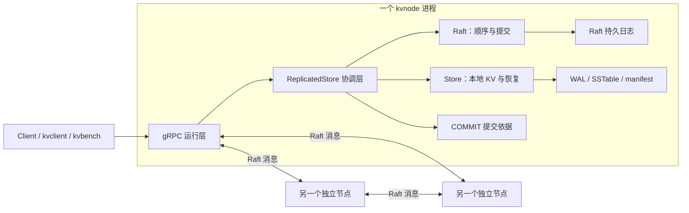

# 项目收尾：架构回顾与验收

原规划第 0—19 步的开发及约定范围内的自动化验证已经完成。最初的两项工程目标都有实现和验证证据：单机 LSM 引擎，以及基于 Raft/gRPC 的三节点复制、故障恢复和混合负载测量。

本文件完成最后的架构回顾交付，供串联各步骤和后续维护使用。个人是否已经掌握，需要通过实际讨论确认；文档交付不会自动把 GOAL.md 中的个人理解项勾选。

原范围完成后又加入[奇数规模成员配置](steps/20-odd-membership.md)，以下总体路径继续适用；第 19 步性能数据保留为当时的三节点基线。

## 先看整个系统



图中展示三节点默认示例。集群可以在启动时配置正奇数个成员，各节点有独立目录和完整组件。节点内部是普通 C++ 对象调用；节点之间才使用 gRPC。成员 ID 和端口可以配置，任意成员都可能当选 Leader，运行期间成员集合固定。

| 层 | 负责什么 | 读代码的入口 |
| --- | --- | --- |
| Client | 找 Leader、总期限、成功/未知结果和安全重试 | [client.cpp](../src/rpc/client.cpp) 的 Call |
| gRPC 运行层 | 接收 RPC、推进时间、发送消息，串行访问协调层 | [node_server.cpp](../src/rpc/node_server.cpp) 的 Write、Read、WaitApplied |
| Raft | 选举、复制、冲突修正与提交位置 | [node.cpp](../src/raft/node.cpp)、[replication.cpp](../src/raft/replication.cpp) |
| 协调层 | 保存提交依据，把已提交命令顺序交给 Store | [replicated_store.cpp](../src/replica/replicated_store.cpp) 的 SaveCommit、ApplyCommitted |
| Store | 本地持久化、查询、刷盘、合并与恢复 | [store.cpp](../src/engine/store.cpp)、[后台刷盘](../src/engine/background_flush.cpp)、[后台合并](../src/engine/background_compaction.cpp) |

## 一次写入为什么可以返回成功

以 Put(name, Alice) 为例：

```text
Client 找到 Leader，发 KeyValue.Write
  → Leader 追加并同步 Raft 日志
  → 向 Follower 复制，符合当前任期的多数派提交规则
  → 协调层持久保存 COMMIT 依据
  → Store 追加并同步自己的 WAL，更新 MemTable
  → 推进 last_applied，客户端收到 Ok
```

多数派为 floor(N / 2) + 1，三节点的多数派是两个，五节点是三个。成功不要求全部 Store 都已经执行，也不要求先生成 SSTable。Follower 之后根据 Leader 的提交位置顺序执行。单节点自成多数派，仍要持久化和执行，但没有节点故障容错能力。

Raft 的 commit 表示一条命令已满足复制协议的提交规则；它不是多 key 数据库事务。本项目没有事务、MVCC 或业务操作的原子批次。

结果 Unknown 表示这次写入可能提交，也可能没有；它不撤销已经发生的操作。客户端不自动重发这种写入。只有明确在追加前拒绝的 NOT_LEADER 才允许自动换节点再试。管理工具的 Propose 返回 ACCEPTED 只代表提议接收，不能用来统计正式写入成功。

## 读取为什么也需要 Raft

正式 Client.Get 会在当前 Leader 追加本次独有的 NoOp，等它被多数派确认并执行，再持有节点状态锁检查角色和任期，读取本地 Store。

隔离的旧 Leader 即使还保存 Alice，也无法独自完成新的屏障，因此不会通过正式 Get 返回一致性旧读。kvadmin local-get 直接观察指定节点，允许落后；它用于诊断。

通过屏障后，本地查找顺序为：

```text
可写 MemTable → 冻结 MemTable → 从新到旧的 SSTable
每张表：Bloom 判断 → 块索引定位 → 块缓存或文件读取 → 精确匹配
```

遇到删除标记就返回不存在，不能继续拿旧表的值。Bloom 的“可能存在”也不能直接作为查询成功。当前 Bloom 和块索引在打开表时重建，缓存保存不可变块字节，命中后仍需解析和比较 key。

## 刷盘、合并与两类日志

Store 的 WAL 保存本地尚未由 SSTable 承担的更新，Raft 日志保存集群的命令顺序；两者的回收规则不同。

可写 MemTable 达到默认 4 MiB 阈值后，切换新 WAL，把旧表冻结交给后台。切换时先发布包含新旧 WAL 的 manifest，让两张内存表都能恢复。后台写好 SSTable 后再次发布 manifest，才回收旧 WAL。

只有一个冻结槽。再次需要冻结而槽仍被占用时，写线程会等待并释放 Store 锁；后台完成后唤醒它。

后台 compaction 合并选定的旧 SSTable，对同一个 key 采用较新输入，发布新集合后回收旧文件。合并时新刷出的表仍保留在当前集合中。覆盖全部旧磁盘表且没有历史快照时，可以清理输入里的最终删除标记；独立的部分合并默认保留标记。

Store compaction 不压缩 Raft 日志。目前没有 Raft 快照或日志截断；逻辑日志有 64 MiB 和 1,000,000 条目的上限，每次正式读也消耗日志空间。这是未来长期运行时需要扩展的边界。

## 崩溃后怎样恢复

| 信息 | 启动时的用途 |
| --- | --- |
| raft 及配套文件 | 恢复节点身份、任期、投票和逻辑日志 |
| COMMIT | 验证已保存提交前缀的位置、任期与指纹；不能用日志长度冒充提交位置 |
| data.manifest、SSTable、WAL | 找到本地有效文件，打开 SSTable，从指定 WAL 重建可写/冻结 MemTable |

协调层校验提交依据，打开本地 Store，再顺序重放完整的已保存提交前缀，完成后才暴露服务。Put/Delete 重放的最终 KV 状态可重复，但会重复产生 Store 写入；没有 exactly-once 保证。

SSTable 本身可供查询，不需要重新塞回 MemTable。默认严格校验损坏；显式尾部恢复模式只丢弃不完整的日志后缀，不能把任意损坏数据修复为正确内容。

manifest 和 COMMIT 都采用“写临时文件 → 同步文件 → rename 发布 → 同步目录”的顺序。旧文件要等新引用关系发布后才能回收；启动不能把残留临时文件自动认作正式依据。

## 锁具体保护哪一层

| 锁或等待 | 保护什么、什么时候持有 |
| --- | --- |
| 节点状态锁 | gRPC 回调和计时线程进入 ReplicatedStore 时持有；协议处理和同步持久化串行执行 |
| 提交等待的条件变量 | 等待期间释放节点状态锁，让复制回复和计时继续推进；唤醒后重新取锁检查条件 |
| Store 状态锁 | 保护 MemTable、WAL、manifest、reader 集合和任务状态；前台操作粒度较大 |
| Store 后台任务 | 准备和发布时持锁，写 SSTable、流式合并时释放 Store 状态锁 |
| 每个 peer 的发送锁、缓存锁 | 分别保护消息队列和缓存；发送网络 RPC 不持有节点状态锁 |

释放后台锁后仍安全，依靠冻结表和 SSTable 的不可变性，以及发布时基于当前状态重新校验、保留期间新增内容。notify 只是通知等待者重新检查条件，不代表自动完成工作或自动转交锁。

## 两个原始目标的验收证据

| 原目标 | 已有证据 |
| --- | --- |
| LSM 引擎：WAL、SSTable、后台 compaction、Bloom、block cache | [单机架构](storage-engine.md)和[第 10 步集成验证](steps/10-engine-integration.md)，各功能步骤记录在开发路线中 |
| Raft/gRPC 三节点复制与故障恢复 | [第 14 步提交规则](steps/14-raft-replication.md)、[第 15 步 Store 接入](steps/15-raft-store.md)、[第 18 步真实三进程故障矩阵](steps/18-cluster-faults.md) |
| 混合负载吞吐量与尾延迟 | [第 19 步测量方法](steps/19-benchmark.md)和[全部 12 轮本机结果](benchmarks/step19-local.md)，共 12,000 次正式调用全部 Ok |
| 奇数规模扩展及完整回归 | [第 20 步](steps/20-odd-membership.md)记录新规模、多数派、旧格式兼容和最新回归；第 19 步当时为各 25/25 组 |

当前默认无 gRPC 构建有 20 组，普通网络配置有 25 组，启用 benchmark 测试后有 27 组。原性能分位数来自完整 Client 调用，包含 Leader 发现和读屏障；工作集落在 MemTable，不能据此评价大 SSTable、冷缓存或长期合并性能。故障测试覆盖有限本机场景，没有实际断电或跨机器验证。

第 19 步的性能数值保留当时记录；第 20 步补充成员扩展与功能回归验证，不将测试耗时解释为新的性能数据。[英文 README](../README.md) / [中文 README](../README.zh-CN.md)提供构建、不同成员数的启动、客户端、测试和 benchmark 命令。

## 怎样用自己的话介绍

可以沿着这段顺序讲，再按上面的路径展开：

> 每个节点内部有一个 LSM 存储引擎，用 WAL 恢复未刷盘状态，用不可变 SSTable 查询旧数据，后台负责刷盘与合并，并用 Bloom、块索引和共享缓存减少查找开销。配置好的正奇数个节点通过 gRPC 运行 Raft，先复制并提交命令，再由协调层按顺序应用到本地 Store。客户端写入等待执行确认，读取通过新的 NoOp 屏障。项目验证了进程崩溃、网络分区与消息故障，也记录了本机三节点混合负载的吞吐量与尾延迟。

讨论时重点解释四件事：为什么有两类日志、写入何时才成功、旧 Leader 为什么不能返回正式旧读、发布新文件与回收旧文件为什么必须按顺序。这份材料已经交付；个人理解项保留给实际讨论确认，后续扩展也由后续需求决定。
